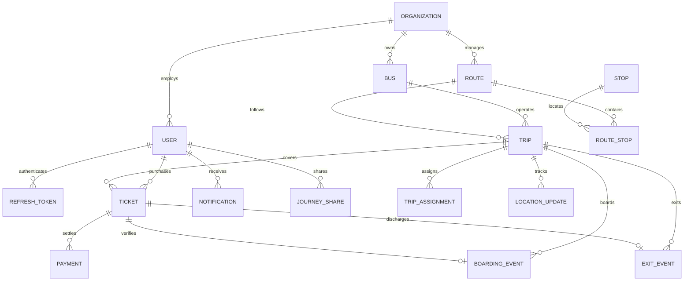

# Database Schema Specification: Smart Public Bus System

The system uses a normalized relational PostgreSQL database managed via Prisma ORM.

## Entity Relationship Overview

---

## Model Descriptions & Constraints

### 1. `Organization`
Multi-tenant isolation entity. Bus owners only access data linked to their organization.
- `id`: UUID (Primary Key)
- `name`: String
- `code`: String (Unique)

### 2. `User`
Accounts for all platform roles: `PASSENGER`, `DRIVER`, `CONDUCTOR`, `BUS_OWNER`, `ADMIN`.
- `id`: UUID
- `email`: String (Unique index)
- `passwordHash`: Bcrypt hash (Salt rounds: 12)
- `role`: UserRole Enum
- `organizationId`: Foreign key to `Organization` (Nullable for passengers/platform admins)

### 3. `Bus`
Physical fleet inventory.
- `id`: UUID
- `registrationNo`: String (Unique)
- `busNumber`: String (Unique)
- `capacity`: Int (Positive constraint)
- `status`: `ACTIVE` | `INACTIVE` | `MAINTENANCE`
- `organizationId`: Foreign key to `Organization`

### 4. `Route`, `Stop`, and `RouteStop`
Ordered transit graph.
- `Route`: Has unique `code`, name, description.
- `Stop`: Physical geographical node with `latitude`, `longitude` coordinates and spatial index.
- `RouteStop`: Junction model maintaining `stopOrder` (1, 2, 3...), `distanceFromStart` (km), and `fareFromStart` (INR).
  - Unique constraint on `[routeId, stopId]`
  - Unique constraint on `[routeId, stopOrder]`

### 5. `Trip` & `TripAssignment`
Scheduled or active bus journeys.
- `Trip`: Links `busId` and `routeId`. Tracks `scheduledStart`, `actualStart`, `actualEnd`, and `status` (`SCHEDULED`, `ACTIVE`, `COMPLETED`, `CANCELLED`).
- `TripAssignment`: Links `tripId` to assigned `driverId` and `conductorId`. Prevents double booking of crew members.

### 6. `LocationUpdate`
High-frequency vehicle telemetry.
- `tripId`: Foreign key to `Trip`
- `latitude`, `longitude`: Float
- `speed`: Float (km/h)
- `heading`: Float (0-360 degrees)
- `accuracy`: Float (meters)
- `timestamp`: DateTime (Indexed for time-series queries)

### 7. `Ticket` & `Payment`
Fare collection and digital ticketing.
- `Ticket`: Contains unique `ticketCode` (UUID), `boardingStopId`, `destinationStopId`, `fare`, and `status` (`PENDING`, `PAID`, `USED`, `CANCELLED`, `EXPIRED`).
- `Payment`: Maintains `amount`, `paymentMethod` (`ONLINE`, `CASH`, `UPI`), `status` (`PENDING`, `SUCCESS`, `FAILED`), and unique `idempotencyKey` preventing duplicate charges.

### 8. `BoardingEvent` & `ExitEvent`
Actual physical passenger movements.
- `BoardingEvent`: Has unique `ticketId` (preventing double boarding of the same ticket) and optional `clientEventId` for offline synchronization deduplication.
- `ExitEvent`: Has unique `ticketId` and optional `clientEventId`.

### 9. `JourneyShare`
Consent-based family location sharing.
- `shareToken`: Unique crypto token.
- `expiresAt`: Automatic expiration timestamp.
- `isActive`: Boolean revoking access upon passenger journey conclusion.
